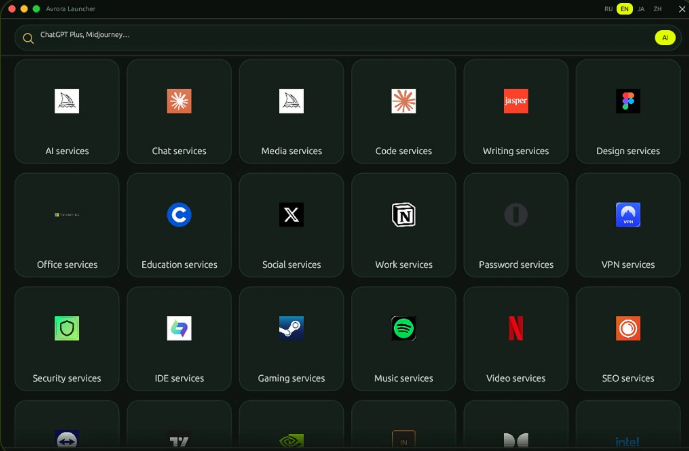

# Miro Pro Free 2026 — unlimited boards, video on canvas, Jira sync

> **Miro is paid everywhere. In our Aivora launcher the same paid Pro version is free.**
>
> Official site / app store = paid Pro subscription. Aivora launcher = that paid Pro product, free on Windows 10 / 11.

**Keywords:** Miro Pro · Miro Pro free · Miro Pro windows · unlimited boards · workshops · paid Miro free through launcher · Aivora Programs

Windows 10 / 11 · Miro Pro · Design SaaS

The orange button opens [https://aivoraprograms.com/](https://aivoraprograms.com/). Install Aivora, then **Activate** **Miro**. You get the **paid Pro** product **for free in our launcher**. No `Miro.exe` in this repository.

## What Miro is

Miro Pro is the paid infinite canvas: **unlimited boards**, private boards, **video chat on the board**, 800+ templates, Jira / Azure sync. The Aivora card is **Pro**, not free Miro with a 3-board cap. This is not Figma Dev Mode and not FigJam-only.

**Miro is paid everywhere else.** Official access is a Pro subscription. In **our Aivora launcher** that same paid Pro is **free** on Windows 10 / 11. No vendor account. No credit card.

## unlimited boards, video on canvas, Jira sync

Unlimited boards is the upgrade. Timer and voting are workshop extras. After **Activate**, open Miro from Design SaaS. This repo is not a .rtb backup.

## Who this Windows page is for

Searches **Miro Pro**, **Miro windows**, **Miro Pro free** wanting **paid Pro**, not the 3-board free plan.

## What the Pro card includes

| Feature | Official Miro | In our Aivora launcher |
|---------|--------------|------------------------|
| Price | Paid Pro subscription | **Free** (same paid Pro) |
| **Unlimited / private boards** | Pro | Same paid Pro, free here |
| **Video on canvas** | Pro | Same paid Pro, free here |
| **Jira / Azure sync** | Pro | Same paid Pro, free here |

## How to open paid Miro on Windows

1. Open [https://aivoraprograms.com/](https://aivoraprograms.com/)
2. Download **Aivora Launcher**
3. Install on **Windows 10** or **Windows 11** (64-bit)
4. Open **Design SaaS**
5. Find **Miro** and press **Activate**

Paid Miro Pro — **free in our launcher**, paid on the official site.

## Search queries this page covers

- **Miro Pro**
- **Miro Pro free**
- **Miro Pro windows**
- **unlimited boards**
- **paid Miro free through launcher**

## Screenshots

Aivora launcher hub — **Design SaaS** → **Miro**:

## FAQ

**Is this Figma?**  
No. Figma Professional is a different Aivora card. This tile is Miro Pro.

**Where is the download?**  
[https://aivoraprograms.com/](https://aivoraprograms.com/)

**Is Miro paid or free?**  
Paid everywhere (official Pro). **Free in our Aivora launcher** — same paid Pro version.

**Do I need a Miro account?**  
No. **Activate** on the tile.

---

## На русском

# Miro Pro бесплатно 2026 — безлимит досок, видео на канве, Jira

> **Везде Miro платный. В нашем лаунчере Aivora та же платная версия Pro — бесплатно.**
>
> Официальный сайт / магазин = платная подписка Pro. Лаунчер Aivora = этот же платный Pro, бесплатно на Windows 10 / 11.

**Ключевые слова:** Miro Pro · Miro бесплатно · Miro Pro windows · безлимит досок · воркшопы · платный Miro бесплатно через лаунчер · Aivora Programs

Оранжевая кнопка — главная Aivora. Лаунчер → **Дизайн SaaS** → **Miro** → **Активировать**. Это **платный Pro**, у нас в лаунчере **бесплатно**.

Miro Pro — платная бесконечная доска: **безлимит бордов**, приватные доски, **видео на канве**, шаблоны, Jira. Карточка Aivora — **Pro**, не free на 3 доски. Это не Figma.

**Miro везде платный.** Официально подписка Pro. **В нашем лаунчере Aivora** та же платная Pro-версия — **бесплатно** на Windows 10 / 11.

Безлимит досок — смысл Pro. Таймер и голосование — воркшоп. Бэкапа досок в git нет.

Запросы **Miro Pro**, **Miro бесплатно** — нужен **платный Pro**.

| Функция | Официально | В нашем лаунчере Aivora |
|---------|------------|-------------------------|
| Цена | Платная подписка Pro | **Бесплатно** (тот же Pro) |
| **Безлимит / приватные доски** | Pro | Та же платная Pro, у нас бесплатно |
| **Видео на канве** | Pro | Та же платная Pro, у нас бесплатно |
| **Синк Jira / Azure** | Pro | Та же платная Pro, у нас бесплатно |

Как открыть: [https://aivoraprograms.com/](https://aivoraprograms.com/) → лаунчер → **Дизайн SaaS** → **Miro** → **Активировать**.

**Это Figma?**  
Нет. Figma — другая карточка. Здесь Miro Pro.

Miro — товарный знак Miro, Inc.. Страница описывает доступ через Aivora Programs.

[https://aivoraprograms.com](https://aivoraprograms.com/) · hello@aivora.app

#windows11 #windows10 #miro #design #aivora

---

*Miro Pro · Miro Pro free · Miro Pro windows · unlimited boards · workshops · paid Miro free through launcher · Aivora Programs · paid Miro free through launcher · Aivora Programs · https://aivoraprograms.com/programs/miro-pro/*
